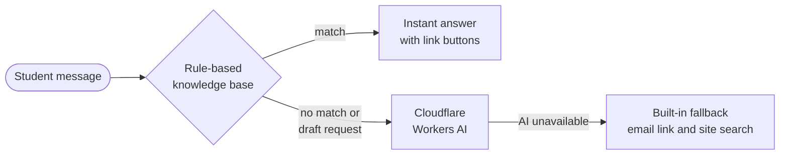
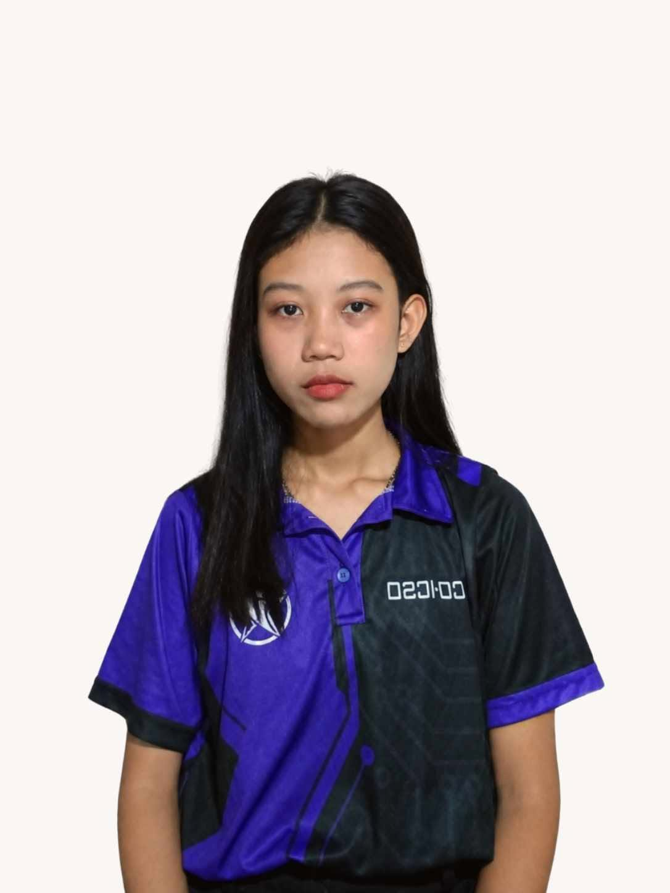

# ESSUGGEST

### The online suggestion box of Eastern Samar State University

*Suggest · Upvote · Improve*

 

 

 

[**Why**](#-why-essuggest) · [**Features**](#-features) · [**Sugi**](#-meet-sugi-the-ai-chatbot) · [**Built with**](#-built-with) · [**Setup**](#-developer-setup) · [**Contact**](#-contact) · [**Team**](#-the-team)

 

## 💡 Why ESSUGGEST

ESSUGGEST is a web application where students can share ideas, vote on polls, and discuss what matters on campus. If you notice something that needs fixing, have an idea for an event, or want to make a suggestion, you can post it, tag it, and choose whether your name shows.

| 📮 The paper suggestion box | ✨ ESSUGGEST |
| :--- | :--- |
| A note goes in and nobody else sees it | Suggestions are public, so everyone can see them |
| Nobody can back an idea up | Students **upvote** and discuss each one |
| Hard to tell what the campus wants | Polls show **live results** |
| Rarely any sign that something happened | The ideas with the most support rise to the top |

 

## ✨ Features

<table>
<tr>
<td width="50%" valign="top">

### 💬 Suggestions
- Write an idea, tag it, and post **anonymously or with your name**
- Other students **upvote** and reply in **threaded discussions**
- Suggestions with the most support rise to the top

</td>
<td width="50%" valign="top">

### 📊 Polls
- Students can create polls
- **One vote per student**, with a **24-hour voting window**
- Results **update live** and stay visible after voting ends

</td>
</tr>
<tr>
<td width="50%" valign="top">

### ✅ Verified accounts
- Sign up with your ESSU credentials: student number, course, year, section, and college
- An account must be verified before you can post, comment, vote, or upvote

</td>
<td width="50%" valign="top">

### 🛡️ Reporting and safety
- Inappropriate content can be reported
- Includes a Reporting Handbook, Community Guidelines, User Guide, and FAQ
- Policies: Data Privacy, Security, IP Rights, and Terms of Use

</td>
</tr>
</table>

> [!NOTE]
> Suggestions do not have a resolved or unresolved status. You can see how much support one has through its upvotes and discussion.

 

## 🤖 Meet Sugi, the AI Chatbot

Sugi is ESSUGGEST's friendly suggestion-box mascot and helper chatbot. She appears as a floating widget on the homepage, About Us, and Contact Us pages. She calls students **"ESSUdyante"** and replies in a soft, warm, slightly Gen Z voice, in English, Filipino, or Taglish.

### What Sugi can help with

| | |
| :--- | :--- |
| 🔑 **Accounts** | Signing up, verifying an account, logging in, and forgotten passwords |
| 📝 **Posting** | Suggestions, anonymous or named posts, upvotes, and comments |
| 🗳️ **Polls** | How polls and voting work |
| 🚩 **Reporting** | Reporting content and where to read the community rules |
| 📚 **Guides** | Policies, guides, and the FAQ |
| 🏫 **About** | What ESSUGGEST is, why it was built, and who made it |
| 📞 **Contacts** | ESSUGGEST Support for bugs and account issues, or the Human Resources Management Office for official, university-level concerns |
| ✍️ **Writing** | Ask her to draft, reword, or polish a suggestion, and she helps make it specific: what the problem is, where it happens, why it matters, and a proposed fix |

### How Sugi answers

Sugi is a hybrid bot with three layers, so the chat never breaks.

1. **Rule-based knowledge base (in the browser).** Common questions get instant answers with buttons that link to the right page.
2. **AI (Cloudflare Workers AI).** Questions the knowledge base can't answer, and requests to draft or reword a suggestion, go to an AI model. If one model is unavailable, the next one takes over.
3. **Built-in fallback.** If the AI is unavailable, Sugi offers a friendly reply, an email link, and a **Search the site** button.

### Chat features

- Starter and follow-up **suggestion chips**, which change depending on the page
- **Link buttons** to the right ESSUGGEST pages
- **Smart follow-ups**: ask "how did they do it?" for deeper details, and she won't repeat herself if you ask the same thing twice
- A **thinking orb** animation while Sugi prepares a reply
- A light, relaxed personality that stays calm and serious on topics like reporting, bullying, and privacy
- Keyboard and screen reader friendly, with support for reduced-motion settings

### The 3D mascot

Sugi is a real 3D character built with CSS 3D transforms, with no images or libraries.

- She **follows your cursor** with her whole body and eyes.
- **Hover** to make her wave and hop. **Click** to make her hop and spin. Click five times fast and she gets dizzy.
- She has moods: happy, thinking, confused, joy, wow, dizzy, sleepy, and yawn.
- When idle she waves, dances, stretches, yawns, and sparkles. If left alone long enough, she falls asleep and wakes up startled when you move the mouse.

<b>⚠️ Limitations</b>

 

- Sugi only covers ESSUGGEST and writing good suggestions. She politely declines other topics.
- She cannot see your account, posts, or poll results, and she cannot post, vote, or report for you.
- Messages are limited to 200 characters.
- Her memory lasts for the current page visit only.
- AI answers can be wrong, so double-check important details in the guides or email support.

<b>🔒 Privacy</b>

 

- **Please don't share personal information** (name, student number, email, phone number) with Sugi.
- Personal details are filtered out in the browser and again on the server before reaching the AI. This is a best-effort filter, not a guarantee.
- Message text is not stored or logged by the chat function.
- Visitor IP addresses are only used to create a one-way hash for a daily usage limit, which expires automatically.
- Only requests from the ESSUGGEST site itself are accepted.
- Replies are cleaned so Sugi never outputs outside links, HTML, or code.

 

## 🧰 Built with

 

## 🛠️ Developer setup

The chatbot runs as a Cloudflare Pages Function. In the Cloudflare dashboard (Pages project, Settings, Bindings), add:

| Binding | Required | Purpose |
| :--- | :---: | :--- |
| `AI` | ✅ Yes | Workers AI |
| `RATE_LIMIT` | ⭐ Recommended | KV namespace for the per-visitor daily cap |
| `HASH_SALT` | Optional | Random secret that hardens the stored visitor hashes |

> [!TIP]
> No API key is stored in the code or the repository.

 

## 📬 Contact

| | |
| :--- | :--- |
| 🛠️ **ESSUGGEST Support** Bugs, account issues, how the platform works | [essuggest@gmail.com](mailto:essuggest@gmail.com) |
| 🏛️ **Human Resources Management Office** Official, university-level concerns | Brgy. Maypangdan, Borongan City, Eastern Samar, 6800 |

 

## 👥 The Team

Built and maintained by **BSIT 3A**, Eastern Samar State University.

<table align="center">
<tr>
<td align="center" width="20%">
 
<b>Jay Anne E. Alcido</b> 
Database Manager
</td>
<td align="center" width="20%">
 
<b>Janica Michi A. Aquino</b> 
Backend Developer
</td>
<td align="center" width="20%">
 
<b>Kaiser Benedict A. Coles</b> 
Frontend Developer
</td>
<td align="center" width="20%">
 
<b>Zoe C. Palce</b> 
Co-Backend Developer
</td>
<td align="center" width="20%">
 
<b>John Benedict A. Villaflor</b> 
Co-Frontend Developer
</td>
</tr>
</table>

 

---

**Suggest. Upvote. Improve.**

&copy; 2026 Eastern Samar State University. All rights reserved.

